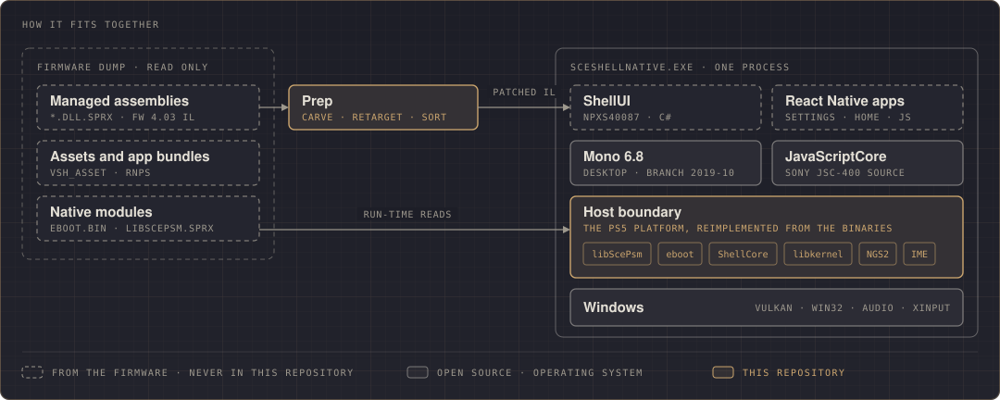

<p align="center">
  
  <h1 align="center">SceShellNative</h1>
  <p align="center">
    <strong>The PlayStation 5 system shell, running natively on Windows: the firmware's own code on top, the console's platform reimplemented underneath, in C++ and Vulkan.</strong>
  </p>
  <p align="center">
    
    
    
    
    
    
    
  </p>
</p>

---

SceShellNative is a launcher that runs the PS5 user interface, the shell the console calls **SceShellUI** (`NPXS40087`), as an ordinary Windows program. It boots the shell from power-on through initial setup and user login to the home screen, with the background, sounds, music and the React Native apps the shell opens, such as Settings.

It is not a remake and it is not an emulator. Nothing in the interface is redrawn: what draws the screens is Sony's own code, read from a firmware dump and run unmodified in its logic. The CPU is not emulated either: that code is C# and JavaScript, which run on a desktop Mono and JavaScriptCore. What this repository writes is the layer between them and the PC: the **platform the PS5 gives the shell**, reimplemented function by function from the firmware's binaries. SceShellNative is an independent project and is not affiliated with Sony Interactive Entertainment.

Nothing from the firmware is part of this repository. The dump is an input, like a BIOS image:

```
SceShellNative.exe --firmware <dump root>
```

## How it fits together

<p align="center"></p>

The shell on the console is a C# program on Sony's fork of Mono, with React Native apps on Sony's JavaScriptCore. Firmware 4.03 still ships that C# as full IL; later firmware ships it compiled ahead of time and stripped. The PS5's Mono is upstream branch 2019-10, so the official desktop Mono 6.8 runs the 4.03 IL.

Each time the shell calls into the console (an `InternalCall` or a `P/Invoke`), the call lands in one of three places:

| Disposition | What answers | Example |
|---|---|---|
| **host** | This repository: a reimplementation of the firmware function, citing its address | `PsmGraphicsContext::Clear`, `BootManager`, the user service, the IME server |
| **library** | An open-source library the firmware itself links, at the same version | Yoga 1.5 for the layout of the React Native apps |
| **stub** | A logged default result, until the shell is seen to need more | everything not reached yet |

**Prep** makes that split. It carves the .NET images out of the firmware's `*.sprx` files, points them at the desktop class libraries and sorts every native entry point into one of the three dispositions. The launcher logs the first call of every stub, so the log is always the up-to-date list of what the shell needs next.

## The rule

The firmware is the source. A value, a branch or a table in this repository was read from the firmware's binaries (decompiled IL, the disassembly of the native modules, resource files), and the code cites the address it reproduces:

```cpp
SSN_ICALL("Sce.PlayStation.Core.Graphics.PsmGraphicsContext::Clear", Clear);
SSN_PINVOKE("libSceBootManager", "SetBootEvent", void, ssn_BootManager_SetBootEvent, (uint64_t e)) { … }
```

Where the console's answer depends on something a PC cannot have (a console identity, a connected service, data missing from the dump), the code says so: the answer is marked `HOST VALUE` or `HOST POLICY`, chosen the way the console would answer without that thing, and logged once. The full list is in [`docs/host-values.md`](docs/host-values.md).

## What is reimplemented

| Area | The firmware it reproduces |
|---|---|
| Graphics | libScePsm's GLES2-style graphics API on Vulkan; the shaders the shell draws with, transcribed to GLSL from its 72 embedded AGC binaries; the GPU texture compressor (BC7) |
| Background | The eboot's BackgroundLayer: the Light theme, the 6000-particle LightParticle layer, the cold boot animation and the transitions, with their shaders |
| Resources, images, text | RCO/CXML resources; PNG and SVG decoding; text on FreeType 2.4.11 and HarfBuzz 1.3.4, the versions libScePsm links |
| Audio | libScePsm's Sound and BGM players over its PSS audio system; the eboot's NGS2 music system; HEVAG and ATRAC9 decoding |
| Video | `PsmVideoPlayer` down to the media framework, with Media Foundation in place of the console's decoder process |
| React Native | `JSCExecutor` over Sony's JavaScriptCore (JSC-400, built from its source); RNPS bundle loading as the console does it |
| System services | ShellCore's user service and login manager, app database, URL configuration, registry, network control, the IME and the system keyboard |
| Input | A DualSense fed from the keyboard or an XInput pad, registered on the device bus as the console registers a USB pad |

How each piece works: [`docs/architecture.md`](docs/architecture.md).

## Status

From a complete FW 4.03 dump, the shell runs the console's own path:

- **Power-on.** The health warning and the cold boot animation, with the LightParticle effects and the boot sounds.
- **Initial setup, end to end.** It finishes with the user created, the per-user app database written and the home populated.
- **Login.** The PS button turns the pad on, user selection appears, and login runs through the eboot's login path.
- **Home.** The tile icons are compressed on the GPU as on the console, with the background and the home's music.
- **Settings.** The real React Native app, through its categories, with text entry through the system IME.

What is not reproduced yet is logged once, the first time the shell reaches it.

## Building

Requirements: Visual Studio 2026 (MSVC toolset and Windows SDK), LLVM `clang-cl`, CMake 3.25 or later, Ninja, and the Vulkan SDK.

```
powershell -File tools\fetch_deps.ps1     # Mono 6.8 (MSI, extracted locally) + Yoga 1.5 into deps\
powershell -File tools\jsc\build_jsc.ps1  # Sony's JavaScriptCore (JSC-400) for Win64 into deps\jsc
build.cmd                                 # configure + build into build\
```

## Running

The standard configuration is the complete FW 4.03 dump (`system_b/`, `system_ex_b/` and `rnps/` with the console's decryption outputs). A second root supplies `/preinst/common/font` for the system fonts, because the 4.03 dump has no `/preinst`.

```
build\bin\SceShellNative.exe --firmware <4.03 dump> --overlay <root with preinst/common/font>
                             --registry-db0 <registry.db0> [--cold-boot]
```

Headless runs, frame captures, scripted input and the diagnostics variables are covered in [`docs/running.md`](docs/running.md).

## Where to look

| Question | Where |
|---|---|
| How the pieces fit, from Prep to the swapchain | [`docs/architecture.md`](docs/architecture.md) |
| Every answer the PC gives in place of the console | [`docs/host-values.md`](docs/host-values.md) |
| Command line, captures, input scripts, diagnostics | [`docs/running.md`](docs/running.md) |
| How an app is launched and how a URL resolves to it | [`docs/app-launch.md`](docs/app-launch.md), [`docs/url-config-resolver.md`](docs/url-config-resolver.md) |
| The React Native bridge and JavaScriptCore | [`docs/rn-bridge.md`](docs/rn-bridge.md) |
| libScePsm's shaders and how they are transcribed | [`docs/psm-shaders.md`](docs/psm-shaders.md) |
| Registry, app database, input, IME | [`docs/registry.md`](docs/registry.md), [`docs/app-db.md`](docs/app-db.md), [`docs/input.md`](docs/input.md), [`docs/ime.md`](docs/ime.md) |
| Measuring the native boundary of the managed set | [`tools/boundary/README.md`](tools/boundary/README.md) |

## Tools

| Tool | Does |
|---|---|
| `tools/sprx_pe.py` | Extracts the managed PE from `.sprx` files |
| `tools/ida/` | idalib (IDA 9) scripts: makes PS5 modules loadable, names registered icalls, decompiles, lists tables |
| `tools/boundary/` | Inventories the managed set's native boundary and attributes every entry point to a firmware module |
| `tools/shaders/` | Dumps libScePsm's embedded shaders; `isa2glsl.py` transcribes RDNA shaders to GLSL |
| `tools/rco_dump/` | Standalone RCO/CXML and image decode checker |
| `tools/registry/` | Decodes the kernel's `registry.db0` |
| `tools/jsc/` | Reproducible build of Sony's JavaScriptCore for Win64 |
| `managed/Tests/` | Renderer and text smoke tests that drive the firmware's own `Sce.PlayStation.Core` |

## Acknowledgments

**basedempth** ([@exhaustiblewizard](https://github.com/exhaustiblewizard)) supplied the complete FW 4.03 devkit dump this project runs on. It carries the console's decryption outputs of its own RNPS bundles, so the shell's JavaScript and native sides match at last. Before that, basedempth was the first to get the 4.03 VSH running under emulation, proving it boots, and pointed the way to the Globe devkit archives and to the native modules the React Native host registers.

The FW 4.03 managed set with full IL comes from the material **zecoxao** decrypted and shared with the scene.

---

<p align="center">
  Made by <a href="https://github.com/JeanxPereira">JeanxPereira</a>, with thanks to <a href="https://github.com/exhaustiblewizard">basedempth</a>
</p>
